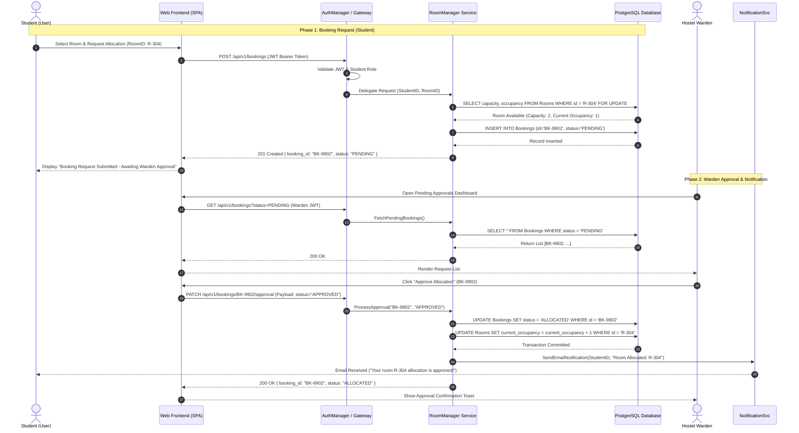
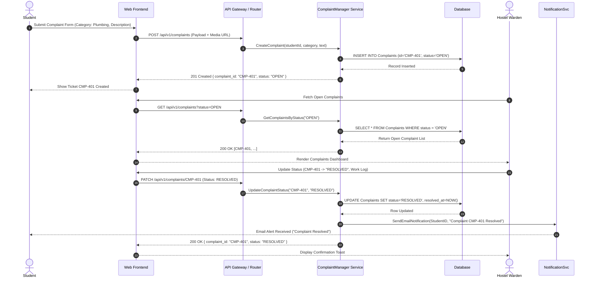

# Software Design Specification (SDS) - Hostel Management System (HMS)

**Standards Reference:** ISO/IEC/IEEE 42010:2022 (Architecture Description) with Detailed Design conventions guided by IEEE 1016-2009 Design Description practices  
**Project Title:** Hostel Management System (HMS)  
**Deliverable:** Part-1 Deliverable 3 (Software Design)  
**Author / Responsible Lead:** Member 4 (Software Design Lead)  
**Date:** September 28, 2026  

---

## 1. Introduction

### 1.1 Purpose
This Software Design Specification (SDS) provides low-level structural, behavioral, and interface specifications for the Hostel Management System (HMS). It bridges the gap between high-level requirements (SRS) and actual implementation by defining object sequence flows, RESTful API endpoint contracts, database state transitions, and RFC 7807-compliant error payloads.

### 1.2 Standards Compliance & Context
- **ISO/IEC/IEEE 42010:2022** forms the primary architectural description framework, governing system viewpoints, component boundaries, and environmental contexts.
- **IEEE 1016-2009** provides established software design description guidelines for internal module decomposition, object interaction sequence models, and detailed interface data contracts.

---

## 2. Detailed Subsystem & Module Design

```text
+------------------------------------------------------------------------------------+
|                         Hostel Management System (HMS)                             |
+-------------------+------------------------------------+---------------------------+
| Module Name       | Core Responsibility                | Interfacing Components    |
+-------------------+------------------------------------+---------------------------+
| AuthManager       | JWT Auth, Password Hashing & RBAC  | Student, Warden, DB       |
| RoomManager       | Room Search & Allocation Workflow  | Student, Warden, Email Svc|
| ComplaintManager  | Issue Logging & Resolution Lifecycle| Student, Warden, DB      |
| FeeManager        | Fee Statement & Receipt Generation | Student, Gateway, DB      |
| NotificationSvc   | Asynchronous Email/Alert Dispatch  | RoomManager, ComplaintSvc |
+-------------------+------------------------------------+---------------------------+
```

---

## 3. UML Sequence Diagrams

### 3.1 Sequence Diagram 1: Student Room Booking Request & Warden Approval Workflow

This sequence models the complete multi-step room allocation lifecycle:
1. **Student Booking Request:** Student submits booking request $\rightarrow$ Room status marked `PENDING`.
2. **Warden Review & Decision:** Warden reviews pending allocation queue and issues approval/rejection.
3. **State Transition & Notification:** Status updates to `ALLOCATED` (or `REJECTED`) and `NotificationSvc` dispatches email alert to student (FR-10).



---

### 3.2 Sequence Diagram 2: Maintenance Complaint Submission & Resolution Workflow



---

## 4. API Design Specification

All endpoints communicate over HTTPS using standard JSON payloads.

### 4.1 Endpoint Matrix

| Verb | Endpoint Path | Description | Access Level | Req ID Mapping |
| :--- | :--- | :--- | :--- | :--- |
| `POST` | `/api/v1/auth/login` | Authenticate user & issue JWT token | Public | FR-01, SEC-01 |
| `GET` | `/api/v1/rooms/available` | Query list of available rooms | Student/Warden | FR-03 |
| `POST` | `/api/v1/bookings` | Submit room allocation request (`PENDING`) | Student | FR-04 |
| `GET` | `/api/v1/bookings/my` | View personal room booking and allocation status | Student | FR-04 |
| `GET` | `/api/v1/bookings` | Fetch pending room booking requests | Warden | FR-05 |
| `PATCH`| `/api/v1/bookings/{id}/approval` | Approve or reject room booking request | Warden | FR-05, SEC-02 |
| `POST` | `/api/v1/complaints` | File maintenance complaint | Student | FR-06 |
| `GET` | `/api/v1/complaints` | Query complaints list by status | Warden | FR-07 |
| `PATCH`| `/api/v1/complaints/{id}` | Update complaint status to RESOLVED | Warden | FR-08, SEC-02 |
| `GET` | `/api/v1/fees/my` | View student fee statement & balance | Student | FR-09 |
| `GET` | `/api/v1/fees/receipt/{id}` | Download digital fee receipt | Student | FR-09 |
| `GET` | `/api/v1/notifications` | Fetch system notifications & alerts | Student/Warden | FR-10 |

---

### 4.2 Endpoint Data Contracts

#### A. Booking Approval / Rejection (`PATCH /api/v1/bookings/{id}/approval`)
- **Headers:** `Content-Type: application/json`, `Authorization: Bearer <Warden_JWT>`
- **Request Body:**
  ```json
  {
    "status": "APPROVED",
    "remarks": "Allocated to A-Block Room R-304"
  }
  ```
- **Success Response (`200 OK`):**
  ```json
  {
    "status": "success",
    "data": {
      "booking_id": "BK-9902",
      "student_id": "USR-1029",
      "room_id": "R-304",
      "status": "ALLOCATED",
      "approved_by": "WARDEN-01",
      "updated_at": "2026-09-28T11:00:00Z"
    }
  }
  ```

#### B. Fee Statement Query (`GET /api/v1/fees/my`)
- **Headers:** `Authorization: Bearer <Student_JWT>`
- **Success Response (`200 OK`):**
  ```json
  {
    "status": "success",
    "data": {
      "student_id": "USR-1029",
      "total_fee": 45000.00,
      "paid_amount": 45000.00,
      "balance_due": 0.00,
      "transactions": [
        {
          "receipt_id": "RCP-8801",
          "amount": 45000.00,
          "payment_mode": "ONLINE_BANKING",
          "paid_at": "2026-09-15T09:30:00Z"
        }
      ]
    }
  }
  ```

---

## 5. Standard Error Handling Specification (RFC 7807 Compliant)

HMS enforces strict **RFC 7807 (Problem Details for HTTP APIs)** payload structure for all non-2xx responses.

### 5.1 RFC 7807 Standard Payload Format
```json
{
  "type": "https://hms.university.edu/errors/room-occupied-conflict",
  "title": "Room Occupancy Conflict",
  "status": 409,
  "detail": "The requested room R-304 has already reached maximum capacity (2/2).",
  "instance": "/api/v1/bookings",
  "invalid_params": [
    {
      "name": "room_id",
      "reason": "Room capacity limit reached"
    }
  ]
}
```

### 5.2 Error Classification & HTTP Status Mapping Matrix

| Category | HTTP Code | Error Type URI | Trigger Condition |
| :--- | :--- | :--- | :--- |
| **Validation** | `400 Bad Request` | `/errors/invalid-input` | Missing required fields or malformed JSON payload. |
| **AuthN** | `401 Unauthorized` | `/errors/authentication-failed` | Expired or invalid JWT token. |
| **AuthZ** | `403 Forbidden` | `/errors/insufficient-permissions` | Student attempting warden approval endpoint. |
| **Not Found** | `404 Not Found` | `/errors/resource-not-found` | Querying invalid booking or complaint ID. |
| **Conflict** | `409 Conflict` | `/errors/room-occupied-conflict` | Room requested is full or under maintenance lock. |
| **Rate Limit** | `429 Too Many Requests`| `/errors/rate-limit-exceeded` | Exceeding 100 requests per minute per IP. |
| **Server Error** | `500 Internal Error` | `/errors/internal-server-error` | Unhandled backend exception or DB timeout. |

---

## 6. Software Design Traceability Matrix

| Design Component / API Endpoint | Sequence Ref | SRS Requirement ID | Architectural Tier |
| :--- | :--- | :--- | :--- |
| `POST /api/v1/auth/login` | N/A | FR-01, SEC-01 | Security Middleware |
| `GET /api/v1/rooms/available` | Seq 3.1 | FR-03 | Data Access Layer |
| `POST /api/v1/bookings` | Seq 3.1 | FR-04 | App Service Layer |
| `GET /api/v1/bookings/my` | Seq 3.1 | FR-04 | App Service Layer |
| `GET /api/v1/bookings` | Seq 3.1 | FR-05 | App Service Layer |
| `PATCH /api/v1/bookings/{id}/approval` | Seq 3.1 | FR-05, SEC-02 | App Service Layer |
| `POST /api/v1/complaints` | Seq 3.2 | FR-06 | App Service Layer |
| `GET /api/v1/complaints` | Seq 3.2 | FR-07 | App Service Layer |
| `PATCH /api/v1/complaints/{id}` | Seq 3.2 | FR-08, SEC-02 | App Service Layer |
| `GET /api/v1/fees/my` | N/A | FR-09 | Data Access Layer |
| `GET /api/v1/notifications` | Seq 3.1, 3.2 | FR-10 | NotificationSvc |
| RFC 7807 Error Handler | All Flows | NFR-01, NFR-04 | Gateway Middleware |
