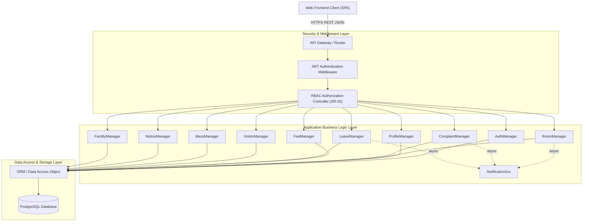
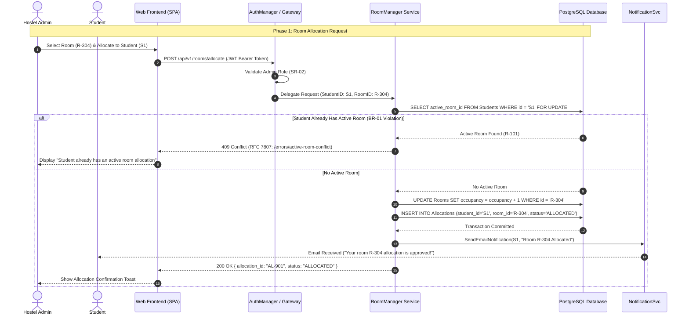
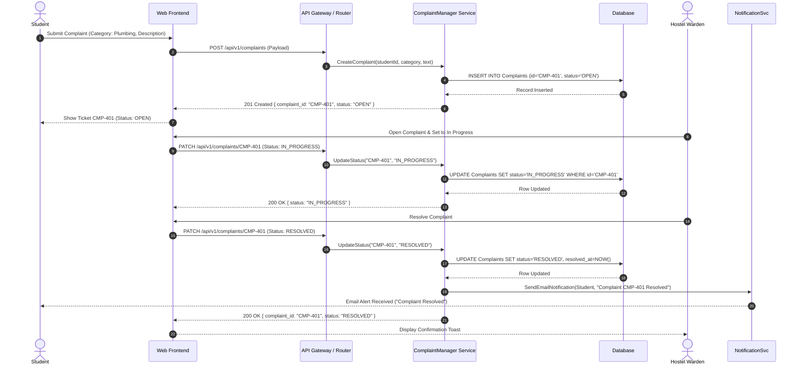

# Software Design Specification (SDS) - Hostel Management System (HMS)

**Standards Reference:** ISO/IEC/IEEE 42010:2022 (Architecture Description) with Detailed Design conventions guided by IEEE 1016-2009 Design Description practices  
**Project Title:** Hostel Management System (HMS)  
**Deliverable:** Part-1 Deliverable 3 (Software Design)  
**Author / Responsible Lead:** Member 4 (Software Design Lead)  
**Date:** September 28, 2026 (Updated Baseline v1.1 Alignment)  

---

## 1. Introduction

### 1.1 Purpose
This Software Design Specification (SDS) provides low-level structural, behavioral, and interface specifications for the Hostel Management System (HMS). It bridges the gap between high-level requirements (SRS Baseline v1.1) and implementation by defining object sequence flows, RESTful API endpoint contracts, database state transitions, and RFC 7807-compliant error payloads.

### 1.2 Standards Compliance & Context
- **ISO/IEC/IEEE 42010:2022** forms the primary architectural description framework, governing system viewpoints, component boundaries, and environmental contexts.
- **IEEE 1016-2009** provides software design description guidelines for internal module decomposition, object interaction sequence models, and detailed interface data contracts.

---

## 2. Architectural Foundation & Detailed Module Design

### 2.1 Architectural Pattern

HMS adopts a **4-Tier Layered Architecture** as its primary architectural pattern. This pattern enforces strict separation of concerns across the Presentation, Gateway/Security, Application Service, and Data tiers—enabling independent scalability and testability of each tier.

```text
+-------------------------------------------------------------------+
|               Presentation Tier (Web Frontend - SPA)              |
+-------------------------------------------------------------------+
                                  |  HTTPS / REST JSON
                                  v
+-------------------------------------------------------------------+
|         API Gateway & Security Middleware (JWT + RBAC)            |
+-------------------------------------------------------------------+
                                  |  Internal Route Dispatch
                                  v
+-------------------------------------------------------------------+
|             Application & Business Logic Service Layer            |
|  [AuthManager] [RoomManager] [ComplaintManager] [FeeManager]      |
|       [LeaveManager] [MessManager] [NotificationSvc] ...          |
+-------------------------------------------------------------------+
                                  |  ORM / Data Access Layer
                                  v
+-------------------------------------------------------------------+
|               Data Tier (PostgreSQL Relational DB)                |
+-------------------------------------------------------------------+
```

**Rationale:** Isolating security enforcement at the gateway tier prevents RBAC bypass (SR-02). Domain services remain independently testable. ACID compliance in the data tier ensures transactional correctness; concurrent-user throughput (NFR-02) is addressed through application-level connection pooling and horizontal scaling of the service tier.

---

### 2.2 Module Responsibility Table

```text
+---------------------------------------------------------------------------------------------------------+
|                                    Hostel Management System (HMS)                                       |
+-------------------+---------------------------------------------------+---------------------------------+
| Module Name       | Core Responsibility                               | Interfacing Components          |
+-------------------+---------------------------------------------------+---------------------------------+
| AuthManager       | Hashed Auth & RBAC (Student, Warden, Admin)       | Student, Warden, Admin, DB      |
| ProfileManager    | Admin Profile Maintenance & Student Read-Only View| Admin, Student, DB              |
| RoomManager       | Room Search & Admin Allocation (BR-01 Enforcement)| Student, Admin, DB, NotificationSvc |
| FeeManager        | Partial Payment & Balance Tracking (BR-03)        | Student, Payment Gateway, DB    |
| ComplaintManager  | Complaint Lifecycle (Open -> In Progress -> Res)  | Student, Warden, DB, NotificationSvc |
| VisitorManager    | Visitor Entry Log & Exit Timestamp (BR-05)        | Warden, DB                      |
| MessManager       | Weekly Mess Menu Publication & Viewing            | Admin, Student, DB              |
| LeaveManager      | Student Leave Request & Warden Decision (BR-02)   | Student, Warden, DB, NotificationSvc |
| NoticeManager     | Admin Notice Broadcast & Student Visibility       | Admin, Student, DB              |
| FacilityManager   | Facility Availability & Conflict-Free Booking     | Student, DB                     |
| NotificationSvc   | Asynchronous Email/Alert Dispatch                 | RoomManager, LeaveManager, ComplaintManager |
+-------------------+---------------------------------------------------+---------------------------------+
```

---

### 2.3 Component Diagram & Component Description

#### Component Diagram (UML)



#### Component Descriptions

| Component | Responsibility | Req Mapping |
| :--- | :--- | :--- |
| **Web Frontend (SPA)** | Renders role-specific dashboards; issues HTTPS REST calls with JWT bearer tokens. | FR-01–FR-09 |
| **API Gateway / Router** | Central ingress; enforces TLS, CORS, rate-limiting, and routes to Security Middleware. | *supports NFR-01/system-level performance* |
| **JWT Authentication Middleware** | Validates JWT signature (RS256), expiry, and claims on every protected request. | SR-01 *(JWT/RS256 — design/implementation decision)* |
| **RBAC Authorization Controller** | Reads `role` claim; enforces per-endpoint access rules (`ROLE_STUDENT`, `ROLE_WARDEN`, `ROLE_ADMIN`). | SR-02 |
| **AuthManager** | Credential validation, bcrypt password comparison, and JWT issuance upon successful login. | SR-01 *(bcrypt — design/implementation decision)* |
| **ProfileManager** | Admin profile maintenance and student read-only profile view. | FR-02, SO-01 |
| **RoomManager** | Enforces BR-01 duplicate-room prevention using pessimistic DB locking; delegates notifications. | FR-01, BR-01 |
| **ComplaintManager** | Manages maintenance ticket state machine (`OPEN → IN_PROGRESS → RESOLVED`); triggers notification on resolution. | FR-04, BR-04 |
| **FeeManager** | Computes running fee balances, records partial payments, generates digital receipt records. | FR-03, BR-03 |
| **LeaveManager** | Records student leave/outpass requests; propagates warden approval with BR-02 validation. | FR-07, BR-02 |
| **VisitorManager** | Logs visitor entry and exit timestamps; enforces BR-05 visitor policy. | FR-05, BR-05 |
| **MessManager** | Publishes and displays weekly mess menu. | FR-06 |
| **NoticeManager** | Broadcasts admin notices to students. | FR-08 |
| **FacilityManager** | Manages facility availability checks and conflict-free slot booking. | FR-09, BR-06 |
| **NotificationSvc** | Asynchronous background service dispatching email alerts on allocation and resolution events. | *Design/implementation decision — supports FR-01, FR-04, FR-07 flows* |
| **ORM / DAO** | Abstracts SQL queries with parameterised statements, preventing SQL Injection. | *Design/implementation decision — parameterised queries prevent SQL injection* |
| **PostgreSQL Database** | Stores all persistent data under ACID compliance; enforces referential integrity. | SO-01 *(ACID/integrity — design decision; availability/NFR-03 is a deployment/infrastructure concern)* |

---

### 2.4 Security Architecture

HMS implements a **defence-in-depth** security model across all architectural tiers:

| Security Control | Mechanism | Requirement Mapping |
| :--- | :--- | :--- |
| **Authentication** | Stateless JWT (RS256) with short-lived access tokens; bcrypt (work factor ≥ 10) for password hashing. | SR-01 *(JWT/bcrypt — design/implementation decisions)* |
| **Authorization (RBAC)** | Server-side role enforcement at the Gateway; roles: `ROLE_STUDENT`, `ROLE_WARDEN`, `ROLE_ADMIN`. | SR-02 |
| **Transport Security** | TLS 1.3 mandatory for all HTTP traffic; HSTS header enforced by the gateway. | SO-02 *(TLS 1.3 — design/implementation decision)* |
| **Input Sanitization** | Centralized middleware validates and sanitizes all query parameters and request bodies against SQL Injection and XSS. | *Design/implementation decision — prevents SQL injection and XSS* |
| **Structured Error Disclosure** | RFC 7807 error payloads return typed, non-verbose details, preventing internal stack-trace leakage. | *Design/implementation decision — prevents stack-trace leakage* |
| **Rate Limiting** | 100 requests/minute per IP enforced at the gateway. | *Design/implementation decision — not an SRS requirement.* |

---

## 3. UML Sequence Diagrams

### 3.1 Sequence Diagram 1: Admin Room Allocation Workflow

This sequence models the **Admin-driven** room allocation lifecycle and BR-01 conflict prevention:
1. **Allocation Request:** Admin selects a room and assigns it to a registered student; the gateway validates the Admin role (SR-02).
2. **State Transition & Validation:** RoomManager checks for an existing active allocation, preventing duplicates (`BR-01`).
3. **State Update & Notification:** On success, room status transitions to `ALLOCATED` and `NotificationSvc` dispatches a confirmation email to the student.



---

### 3.2 Sequence Diagram 2: Maintenance Complaint Lifecycle Workflow (BR-04)



---

## 4. API Design Specification

All endpoints communicate over HTTPS using standard JSON payloads and JWT authentication.

### 4.1 Endpoint Matrix

| Verb | Endpoint Path | Description | Access Level | Req / Rule Mapping |
| :--- | :--- | :--- | :--- | :--- |
| `POST` | `/api/v1/auth/login` | Authenticate user (Admin/Warden/Student) | Public | SR-01 |
| `GET` | `/api/v1/profiles/me` | View the authenticated student's own profile | Student | FR-02, SO-01 |
| `GET`, `POST` | `/api/v1/profiles` | List or create student profiles | Admin Only | FR-02, SR-02 |
| `GET`, `PUT`, `PATCH`, `DELETE` | `/api/v1/profiles/{profile_id}` | View or maintain a student profile | Admin Only | FR-02, SR-02 |
| `POST` | `/api/v1/rooms/allocate` | Allocate room to registered student | Admin Only | FR-01, BR-01 |
| `GET` | `/api/v1/fees/my` | View student fee statement & balance | Student | FR-03, BR-03 |
| `POST` | `/api/v1/fees/pay` | Record partial or full fee payment | Student | FR-03, BR-03 |
| `POST` | `/api/v1/complaints` | File maintenance complaint (`OPEN`) | Student | FR-04, BR-04 |
| `PATCH`| `/api/v1/complaints/{id}` | Progress status (`IN_PROGRESS` / `RESOLVED`)| Warden | FR-04, BR-04 |
| `POST` | `/api/v1/visitors` | Log visitor entry (exit timestamp optional) | Warden | FR-05, BR-05 |
| `PATCH`| `/api/v1/visitors/{id}/exit` | Log visitor exit timestamp | Warden | FR-05, BR-05 |
| `POST` | `/api/v1/mess/menu` | Publish weekly mess menu | Admin | FR-06 |
| `GET` | `/api/v1/mess/menu` | View weekly mess menu | Student / Warden / Admin | FR-06 |
| `POST` | `/api/v1/leave` | Submit leave / outpass request | Student | FR-07, BR-02 |
| `PATCH`| `/api/v1/leave/{id}/decision` | Approve / Reject leave request | Warden | FR-07, BR-02 |
| `POST` | `/api/v1/notices` | Broadcast admin notice to students | Admin | FR-08 |
| `GET` | `/api/v1/facilities/availability`| Check facility availability slots | Student | FR-09, BR-06 |
| `POST` | `/api/v1/facilities/book` | Book facility slot (Conflict check) | Student | FR-09, BR-06 |

---

### 4.2 Endpoint Data Contracts

#### A. Fee Payment Recording (`POST /api/v1/fees/pay`)
- **Headers:** `Content-Type: application/json`, `Authorization: Bearer <Student_JWT>`
- **Request Body:**
  ```json
  {
    "amount": 15000.00,
    "payment_mode": "ONLINE_BANKING"
  }
  ```
- **Success Response (`200 OK`):**
  ```json
  {
    "status": "success",
    "data": {
      "transaction_id": "TXN-7702",
      "paid_amount": 15000.00,
      "previous_balance": 45000.00,
      "remaining_balance": 30000.00,
      "fee_status": "PARTIAL",
      "updated_at": "2026-09-28T11:15:00Z"
    }
  }
  ```

#### B. Facility Booking (`POST /api/v1/facilities/book`)
- **Headers:** `Content-Type: application/json`, `Authorization: Bearer <Student_JWT>`
- **Request Body:**
  ```json
  {
    "facility_id": "FAC-BADMINTON-1",
    "booking_date": "2026-09-29",
    "slot_start": "18:00",
    "slot_end": "19:00"
  }
  ```
- **Conflict Response (`409 Conflict`):**
  ```json
  {
    "type": "https://hms.university.edu/errors/facility-slot-conflict",
    "title": "Facility Slot Already Booked",
    "status": 409,
    "detail": "The requested time slot 18:00-19:00 on 2026-09-29 for FAC-BADMINTON-1 is already booked.",
    "instance": "/api/v1/facilities/book"
  }
  ```

---

## 5. Standard Error Handling Specification (RFC 7807 Compliant)

HMS enforces strict **RFC 7807 (Problem Details for HTTP APIs)** payload structure for all non-2xx responses.

### 5.1 Error Classification & HTTP Status Mapping Matrix

| Category | HTTP Code | Error Type URI | Trigger Condition |
| :--- | :--- | :--- | :--- |
| **Validation** | `400 Bad Request` | `/errors/invalid-input` | Missing required fields or malformed JSON payload. |
| **AuthN** | `401 Unauthorized` | `/errors/authentication-failed` | Expired or invalid JWT token or bad credentials. |
| **AuthZ** | `403 Forbidden` | `/errors/insufficient-permissions` | Student attempting warden/admin endpoint. |
| **Not Found** | `404 Not Found` | `/errors/resource-not-found` | Querying invalid room, complaint, or leave ID. |
| **Conflict** | `409 Conflict` | `/errors/active-room-conflict` | Assigning second active room to student (BR-01). |
| **Conflict** | `409 Conflict` | `/errors/facility-slot-conflict`| Slot already booked by another user (BR-06). |
| **Rate Limit** | `429 Too Many Requests`| `/errors/rate-limit-exceeded` | Exceeding 100 requests/min per IP *(design/implementation decision — not an SRS requirement).* |
| **Server Error** | `500 Internal Error` | `/errors/internal-server-error` | Unhandled backend exception or DB connection loss. |

---

## 6. Software Design Traceability Matrix

| Design Component / API Endpoint | Sequence / Module Ref | Requirement / Rule ID | Architectural Tier |
| :--- | :--- | :--- | :--- |
| `POST /api/v1/auth/login` | AuthManager | SR-01 | Security Middleware |
| `GET /api/v1/profiles/{id}`, `PUT ...` | ProfileManager | FR-02, SO-01 | App Service Layer |
| `POST /api/v1/rooms/allocate` | Seq 3.1 / RoomManager | FR-01, BR-01 | App Service Layer |
| `GET /api/v1/fees/my`, `POST /fees/pay` | FeeManager | FR-03, BR-03 | App Service Layer |
| `POST /complaints`, `PATCH /complaints/{id}`| Seq 3.2 / ComplaintManager | FR-04, BR-04 | App Service Layer |
| `POST /visitors`, `PATCH /visitors/{id}/exit`| VisitorManager | FR-05, BR-05 | App Service Layer |
| `POST /mess/menu`, `GET /mess/menu` | MessManager | FR-06 | App Service Layer |
| `POST /leave`, `PATCH /leave/{id}/decision` | LeaveManager | FR-07, BR-02 | App Service Layer |
| `POST /notices` | NoticeManager | FR-08 | App Service Layer |
| `GET /facilities/...`, `POST /facilities/book`| FacilityManager | FR-09, BR-06 | App Service Layer |
| Security Middleware (JWT + RBAC) | Gateway | SR-01, SR-02 | Gateway Layer |
| Transport Security (TLS 1.3 / HSTS) | API Gateway | SO-02 *(TLS — design/implementation decision)* | Gateway Layer |
| RFC 7807 Error Handler | Gateway Middleware | *Design/implementation decision — structured error disclosure; prevents stack-trace leakage* | Gateway Middleware |

