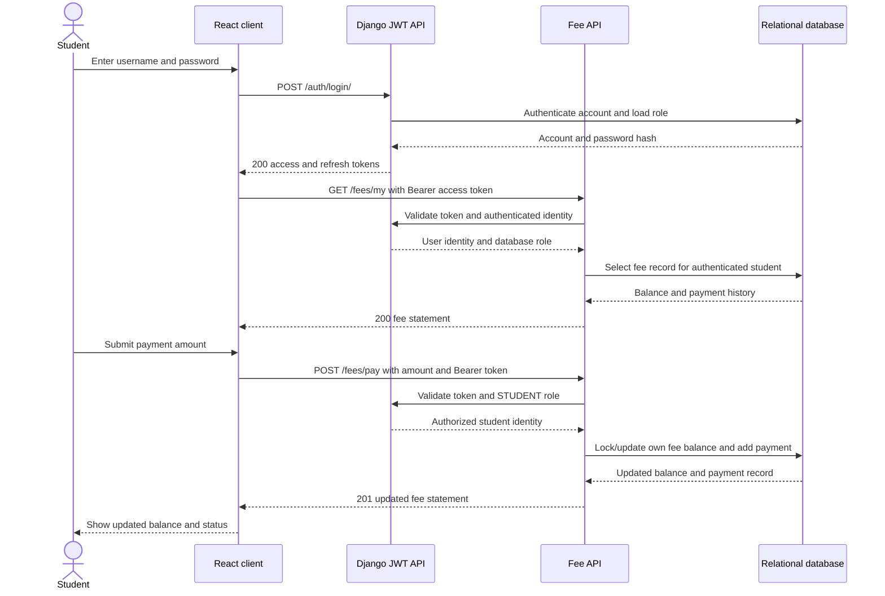
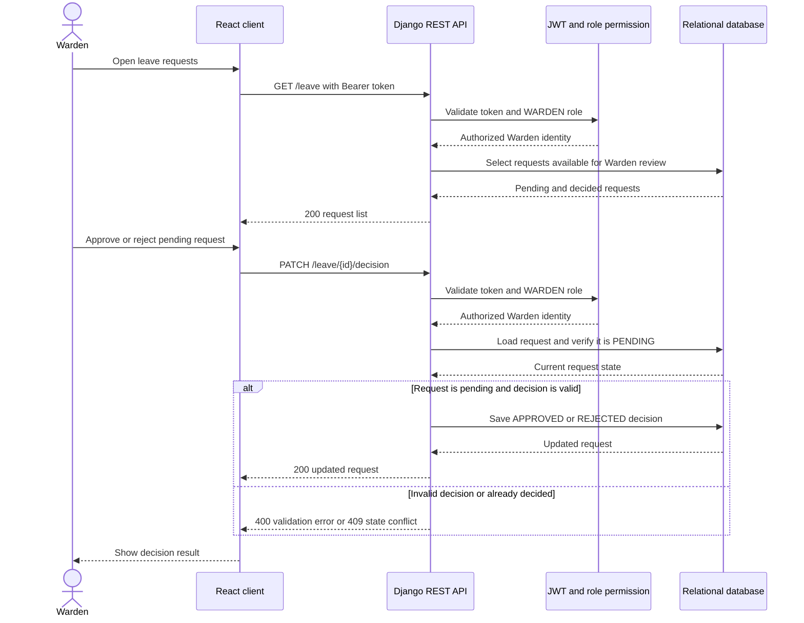

# HMS API and interaction design addendum

This addendum completes the design detail that is outside the scope of the original Software Architecture & Design Specification. It describes the API and two UML sequence flows against the checked-in Django REST implementation. Routes are rooted at `/api/v1`; the authentication routes are rooted at `/api/v1/auth`.

## API conventions

- The browser client calls a Django REST Framework API. Protected routes use a JWT access token in `Authorization: Bearer <token>`.
- A missing, invalid, or expired access token returns `401 Unauthorized`. A valid identity without the required role returns `403 Forbidden`.
- Successful creation uses `201 Created`; reads and updates use `200 OK`; deletes use `204 No Content`.
- Serializer and request validation errors return `400 Bad Request` with field-level details. Missing records return `404 Not Found`. Invalid state transitions and duplicate/conflicting operations use `409 Conflict` where implemented.
- Authorization is based on the authenticated account's database role. Ownership-sensitive student reads and writes use the authenticated student's identity rather than a client-supplied owner.

## Endpoint design

| Area | Method and route | Access / behavior |
|---|---|---|
| Authentication | `POST /api/v1/auth/login/` | Public; exchange credentials for JWT tokens. |
| Authentication | `POST /api/v1/auth/refresh/` | Public token refresh endpoint. |
| Profiles | `GET /api/v1/profiles/me` | Student; read own profile. |
| Profiles | `GET, POST /api/v1/profiles` | Admin; list or create profiles. |
| Profiles | `GET, PUT, PATCH, DELETE /api/v1/profiles/{profile_id}` | Admin; maintain a profile. |
| Rooms | `GET /api/v1/rooms/` | Admin; inspect inventory and capacity. |
| Allocations | `GET, POST /api/v1/allocations/` | Admin; list or create allocations. |
| Allocations | `PATCH /api/v1/allocations/{allocation_id}/release` | Admin; release an active allocation. |
| Fees | `GET /api/v1/fees/my` | Student; read own balance and payment history. |
| Fees | `POST /api/v1/fees/pay` | Student; record a payment against own balance. Overpayment is rejected. |
| Fees | `GET, POST /api/v1/fees/records` | Admin; list or create fee records. |
| Fees | `GET, PATCH /api/v1/fees/records/{id}` | Admin; inspect or update a fee record. |
| Complaints | `GET, POST /api/v1/complaints` | Student creates and tracks own complaints; Student and Warden can list complaints (students see only their own). |
| Complaints | `PATCH /api/v1/complaints/{complaint_id}` | Warden; apply the next valid complaint status. |
| Visitors | `GET, POST /api/v1/visitors` | Warden; list history or record entry. |
| Visitors | `PATCH /api/v1/visitors/{visitor_id}/exit` | Warden; record exit once. |
| Mess | `GET /api/v1/mess/menu` | Authenticated roles; view the current published menu. |
| Mess | `POST /api/v1/mess/menu` | Admin; publish or replace a weekly menu. |
| Leave | `GET, POST /api/v1/leave` | Student creates and reads own requests; Warden reads requests for decision. |
| Leave | `PATCH /api/v1/leave/{leave_id}/decision` | Warden; approve or reject a pending request. |
| Notices | `GET, POST /api/v1/notices` | Student/Admin may read; Admin creates notices. Wardens are denied. |
| Notices | `GET, PATCH, DELETE /api/v1/notices/{notice_id}` | Admin manages notices; students can read visible published notices. |
| Facilities | `GET /api/v1/facilities/` | Student; browse active facilities. |
| Facilities | `GET /api/v1/facilities/{facility_id}/availability/?date=YYYY-MM-DD` | Student; view available and booked slots for a date. |
| Facilities | `POST /api/v1/facility-bookings/` | Student; book a non-conflicting slot. |
| Facilities | `GET, POST /api/v1/staff/facilities/` | Warden/Admin; list or create facilities. |
| Facilities | `GET, PUT, PATCH /api/v1/staff/facilities/{id}/` | Warden/Admin; inspect or update a facility. |

The profile API intentionally differs from the initial design's student-ID routes: student self-service uses `/profiles/me`; administrative collection and record routes are role-restricted. This accepted implementation difference is also recorded in `IMPLEMENTATION_DEVIATIONS.md`.

## Sequence diagram: student login and self-service fee payment

The API derives the fee owner from the access token. Invalid amounts, including amounts exceeding the outstanding balance, are rejected with a validation error and do not create a payment.

## Sequence diagram: Warden leave decision

## Error handling and security protocol

| Condition | HTTP response | Client behavior |
|---|---:|---|
| Missing, malformed, or expired token | `401` | Prompt for sign-in; refresh where a valid refresh token is available. |
| Authenticated user lacks role permission | `403` | Show an access-denied message; do not retry as another role. |
| Invalid field, date, amount, or query parameter | `400` | Show field-level validation feedback and preserve the form where practical. |
| Requested record does not exist | `404` | Show a not-found state and refresh the affected list. |
| Duplicate action, occupied capacity/slot, or invalid state transition | `409` | Explain the conflict and refresh current state before retrying. |
| Unexpected server/network error | `5xx` or network failure | Show a generic retry message; keep implementation details and secrets out of the user interface. |

The API checks role permissions on the server for every protected operation. Client-side route guards and navigation are presentation aids and are not treated as authorization controls. Sensitive details, credentials, and access tokens must not be written into user-facing error messages or demonstration recordings.

## Traceability

| Requirement area | API/design evidence |
|---|---|
| Authentication and role access | Login, JWT-protected routes, `401`/`403` protocol; both diagrams. |
| Profile management | `/profiles/me` and Admin profile collection/detail routes. |
| Fees and payment rules | `/fees/my`, `/fees/pay`, staff fee routes; payment sequence and `400` validation behavior. |
| Leave approval | Leave routes and Warden decision sequence; invalid/repeated decisions are rejected. |
| Complaints, visitors, menu, notices | Endpoint table and role-specific access. |
| Facility availability and booking | Availability, booking, and staff catalog routes; conflict response. |
| Error handling | Shared response table and client behavior. |

This addendum documents implementation and design contracts; it does not by itself claim that all acceptance targets have passed. Test outcomes and limitations are recorded separately in the execution reports.
